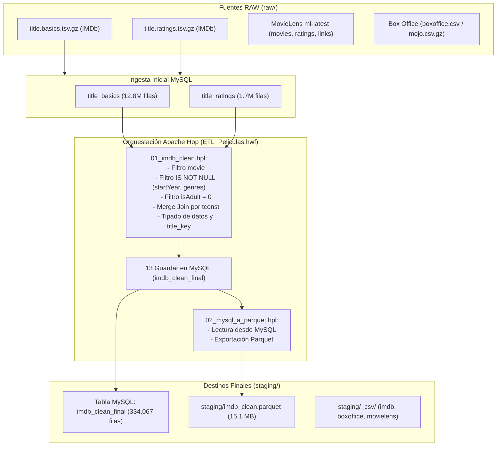

# Documentación Integral del Proyecto ETL — Películas (Apache Hop + MySQL + Parquet + Power BI)

> **Ubicación del Proyecto:** `C:\Users\diego\Downloads\apachehopETL`  
> **Fecha de Actualización:** Octubre 2026  
> **Estado:** Rutas y configuraciones operativas al 100%  

---

## 1. Resumen Ejecutivo del Proyecto

El objetivo de este proyecto es construir un pipeline de datos (ETL) robusto, automatizado y escalable que extraiga millones de registros cinematográficos de fuentes públicas heterogéneas (**IMDb**, **MovieLens** y **Box Office Mojo/Kaggle**), realice tareas avanzadas de limpieza, tipado y descarte de anomalías, y consolide los datos limpios en dos destinos clave:
1. **Base de Datos MySQL (`imdb.imdb_clean_final`)**: Para persistencia relacional, transaccional y consultas analíticas ad-hoc mediante SQL.
2. **Archivo Columnar Parquet (`staging/imdb_clean.parquet`)**: Para optimizar la velocidad de carga, compresión y rendimiento analítico en herramientas de Business Intelligence como **Power BI**.

---

## 2. Arquitectura y Componentes del Sistema



---

## 3. Fuentes RAW: Archivos, Registros y Análisis de Campos

A continuación se detallan todas las fuentes de datos crudas (`raw/`), sus campos originales, qué campos son realmente importantes y cuáles fueron descartados:

### 3.1. IMDb: `title.basics.tsv.gz` (y tabla MySQL `title_basics`)
* **Tamaño comprimido:** ~228.8 MB | **Filas totales:** 12,876,214
* **Campos originales completos:**
  1. `tconst` (String, ej. `tt0000001`): Identificador único universal del título.
  2. `titleType` (String): Categoría (`movie`, `tvSeries`, `tvEpisode`, `short`, `video`, etc.).
  3. `primaryTitle` (String): Título oficial/popular en su lanzamiento internacional.
  4. `originalTitle` (String): Título en idioma original.
  5. `isAdult` (Integer/Byte): `0` = No adulto, `1` = Contenido adulto.
  6. `startYear` (Integer/String): Año de estreno o lanzamiento.
  7. `endYear` (Integer/String): Año de fin (para series de TV).
  8. `runtimeMinutes` (Integer/String): Duración en minutos.
  9. `genres` (String): Lista separada por comas de hasta 3 géneros.

* **Campos importantes seleccionados para el Pipeline:**
  * `tconst` *(Llave primaria de unión)*
  * `titleType` *(Clave para filtrado de películas)*
  * `primaryTitle` *(Título que se renombra a `title`)*
  * `startYear` *(Dimensión temporal y para desambiguar homónimos)*
  * `isAdult` *(Criterio de filtrado de contenido apto)*
  * `genres` *(Análisis de categorías cinematográficas)*

* **Campos descartados y motivo:**
  * `originalTitle`: Para la analítica general en Power BI se prioriza el título comercial internacional (`primaryTitle`) y se reduce el peso de memoria.
  * `endYear`: No aplica a largometrajes (`movie`); solo tiene valor para series.
  * `runtimeMinutes`: Presenta alto porcentaje de valores vacíos (`\N`) y no era mandatorio para los KPIs de popularidad/rating requeridos.

---

### 3.2. IMDb: `title.ratings.tsv.gz` (y tabla MySQL `title_ratings`)
* **Tamaño comprimido:** ~8.7 MB | **Filas totales:** 1,722,741
* **Campos originales completos:**
  1. `tconst` (String): Identificador único de título (FK a `title.basics`).
  2. `averageRating` (Decimal/Float): Puntuación media ponderada de 1.0 a 10.0.
  3. `numVotes` (Integer): Cantidad de usuarios que votaron por el título.

* **Campos importantes seleccionados:**
  * Los tres campos (`tconst`, `averageRating`, `numVotes`) son esenciales para medir la calidad y popularidad del catálogo.

---

### 3.3. MovieLens (`raw/ml-latest/`)
* **Películas:** 86,537 | **Valoraciones:** 33,832,162
* **Archivos y Campos:**
  * `movies.csv`:
    * `movieId` (Int): ID interno de MovieLens.
    * `title` (String): Incluye el año entre paréntesis (ej. `Toy Story (1995)`).
    * `genres` (String): Géneros separados por tubería (`|`) (ej. `Adventure|Animation|Children`).
  * `links.csv` (**Atajo crítico de integración**):
    * `movieId` (Int)
    * `imdbId` (Int): ID de IMDb sin prefijo (ej. `114709`).  
      *Cálculo de enlace exacto:* `tconst = 'tt' + LPAD(imdbId, 7, '0')` (100% de coincidencias sin nulos).
    * `tmdbId` (Int): ID de The Movie Database.
  * `ratings.csv`:
    * `userId`, `movieId`, `rating`, `timestamp`.

---

### 3.4. Box Office (`boxoffice.csv` y `boxoffice_mojo_daily.csv.gz`)
* **Filas:** 7,668 (cobertura 1980–2020)
* **Campos originales en `boxoffice.csv`:**
  * `name`, `rating`, `genre`, `year`, `released`, `score`, `votes`, `director`, `writer`, `star`, `country`, `budget`, `gross`, `company`, `runtime`.
* **Campos importantes seleccionados:**
  * `name` (renombrado a `title` y normalizado a `title_key`).
  * `year` (clave conjunta de cruce).
  * `budget` (Presupuesto de producción en USD).
  * `gross` (Recaudación mundial en USD).
  * `director` (Para análisis de directores más taquilleros).
* **Campos descartados:**
  * `released`, `writer`, `star`, `country`, `company`, `runtime`: Descartados para evitar redundancia o por exceso de granularidad respecto al foco financiero.

---

## 4. Reglas de Filtrado y Transformación (Pipeline `01_imdb_clean.hpl`)

Durante el proceso de extracción y limpieza se aplican filtros estrictos para garantizar la calidad del dato:

| Orden | Paso / Transform | Condición / Filtro | Justificación y Filas Descartadas |
|---|---|---|---|
| 1 | **01 Leer title.basics** | `titleType = 'movie'` | Se ejecuta directo en el query SQL de entrada. De **12.8M** registros, **12.1M** son episodios, cortos, videojuegos, documentales de TV, etc. Solo **759,906** son películas reales. |
| 2 | **02 Solo peliculas** | `titleType = 'movie'` | Filtro de redundancia y seguridad en Hop para asegurar que ningún registro no cinematográfico pase al flujo. |
| 3 | **03 Con anio** | `startYear IS NOT NULL` | Elimina películas sin año de estreno (que en el raw venían como `\N`). Descarta **113,722 registros** (15% del total de películas). |
| 4 | **04 Con genero** | `genres IS NOT NULL` | Elimina películas sin información de género cinematográfico. Descarta **77,835 registros**. |
| 5 | **05 Sin contenido adulto** | `isAdult = 0` | Filtra **9,106 películas** clasificadas como cine adulto/pornográfico para mantener un catálogo general apto. |
| 6 | **06 & 08 Ordenar por tconst** | `tconst ASC` | Ordenamiento obligatorio en disco/memoria antes de un `Merge Join`. |
| 7 | **09 Merge join por tconst** | `INNER JOIN` (basics ⨝ ratings) | Descarta películas que **no tienen valoraciones ni votos en IMDb** (solo títulos con feedback real de la audiencia). |
| 8 | **10 Campos finales y tipos** | Casting & Rename | Renombra `primaryTitle` → `title`. Convierte tipos de texto crudo a numéricos reales (`Integer` y `Number(3,2)`). |
| 9 | **11 Clave de titulo** | `title_key = LOWER(TRIM(title))` | Genera una clave estandarizada sin mayúsculas ni espacios residuales para posibilitar cruces con fuentes externas como Box Office. |
| 10 | **13 Guardar en MySQL** | Truncate & Batch Insert | Inserta las filas depuradas en la tabla `imdb_clean_final` con commits por lotes de 5,000 registros. |

---

## 5. Esquema de Datos Finales (Staging y Producción)

Tras la ejecución del flujo, el conjunto resultante consta de **334,067 películas completamente limpias**.

### Esquema de la Tabla MySQL `imdb_clean_final` / Parquet `imdb_clean.parquet`

| Campo | Tipo Hop | Tipo MySQL | Descripción y Formato | Ejemplo |
|---|---|---|---|---|
| `tconst` | String | `VARCHAR(12)` | Identificador alfanumérico único de IMDb (PK) | `tt0111161` |
| `title` | String | `VARCHAR(255)` | Título internacional comercial de la película | `The Shawshank Redemption` |
| `title_key` | String | `VARCHAR(255)` | Título en minúsculas y sin espacios laterales (para cruces) | `the shawshank redemption` |
| `startYear` | Integer | `INT` | Año oficial de lanzamiento (1894–2026) | `1994` |
| `genres` | String | `VARCHAR(255)` | Lista de géneros separados por coma | `Drama` |
| `averageRating` | Number | `DECIMAL(3,2)` | Calificación promedio de usuarios (de 1.0 a 10.0) | `9.30` |
| `numVotes` | Integer | `INT` | Número total de votos recibidos | `2800000` |

---

## 6. Estrategia de Cruces y Desambiguación (Joins)

1. **IMDb con MovieLens:**
   * **Método:** Cruce exacto por clave primaria `tconst`.
   * **Mecanismo:** A través de `raw/ml-latest/links.csv` se toma el campo `imdbId` (ej. `114709`) y se interpola como `'tt' + LPAD(imdbId, 7, '0')` (`tt0114709`), logrando un match determinista sin margen de error.

2. **IMDb con Box Office:**
   * **Método:** Cruce por clave compuesta: `title_key` + `year` (o `startYear`).
   * **Causa técnica:** Unir únicamente por título genera duplicados graves debido a **homónimos en distintas épocas** (por ejemplo: *The Avengers* de 1998 vs. *The Avengers* de 2012; *Parasite* de 1982 vs. *Parasite* de 2019). La combinación con el año garantiza unicidad.

---

## 7. Consultas SQL Analíticas de Referencia (`consultas.sql`)

El archivo [**`consultas.sql`**](file:///C:/Users/diego/Downloads/apachehopETL/consultas.sql) incluye análisis listos para validar el dataset sobre MySQL:

1. **Resumen General:**
   ```sql
   SELECT COUNT(*) AS peliculas, ROUND(AVG(averageRating), 2) AS nota_media, SUM(numVotes) AS votos_totales
   FROM imdb_clean_final;
   ```
2. **Top 10 Películas Mejor Valoradas (con representatividad $\ge$ 100,000 votos):**
   ```sql
   SELECT title, startYear, averageRating, numVotes
   FROM imdb_clean_final
   WHERE numVotes >= 100000
   ORDER BY averageRating DESC, numVotes DESC
   LIMIT 10;
   ```
3. **Evolución por Década:**
   ```sql
   SELECT FLOOR(startYear / 10) * 10 AS decada, COUNT(*) AS peliculas, ROUND(AVG(averageRating), 2) AS nota_media
   FROM imdb_clean_final
   WHERE startYear BETWEEN 1950 AND 2029
   GROUP BY decada ORDER BY decada;
   ```
4. **Desagregación Recursiva de Géneros Múltiples:**
   Permite partir listas de géneros (`Drama,Crime`) en filas individuales para análisis dimensional sin distorsionar los promedios.

---

## 8. Rutas Absolutas Actualizadas en el Proyecto

Todos los archivos de configuración y ejecución apuntan de manera autocontenida a la carpeta actual:

* **Workflow orquestador:** [**`ETL_Peliculas.hwf`**](file:///C:/Users/diego/Downloads/apachehopETL/ETL_Peliculas.hwf)
  * Acción 1: `C:/Users/diego/Downloads/apachehopETL/01_imdb_clean.hpl`
  * Acción 2: `C:/Users/diego/Downloads/apachehopETL/02_mysql_a_parquet.hpl`
* **Pipeline Parquet:** [**`02_mysql_a_parquet.hpl`**](file:///C:/Users/diego/Downloads/apachehopETL/02_mysql_a_parquet.hpl)
  * Destino: `C:/Users/diego/Downloads/apachehopETL/staging/imdb_clean.parquet`
* **Configuración del Proyecto:** [**`project-config.json`**](file:///C:/Users/diego/Downloads/apachehopETL/project-config.json)
* **Metadata de Conexión a Base de Datos:** [**`metadata/rdbms/imdb_mysql.json`**](file:///C:/Users/diego/Downloads/apachehopETL/metadata/rdbms/imdb_mysql.json)
* **Consola Rápida Docker / MySQL:** [**`CONSULTAS_MYSQL.bat`**](file:///C:/Users/diego/Downloads/apachehopETL/CONSULTAS_MYSQL.bat)
