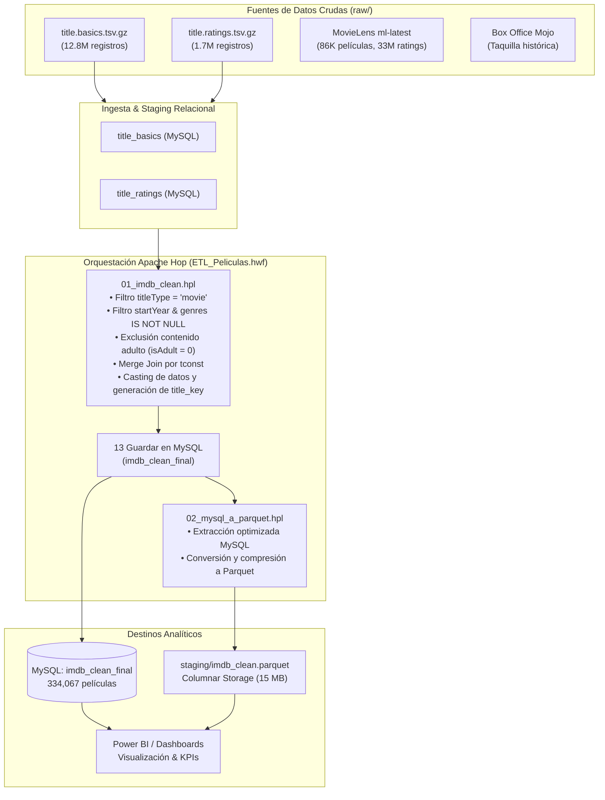

# 🎬 Movies ETL Pipeline — Apache Hop & Analytical Warehouse

[](https://hop.apache.org/)
[](https://www.mysql.com/)
[](https://parquet.apache.org/)
[](https://powerbi.microsoft.com/)
[](https://opensource.org/licenses/MIT)

Pipeline automatizado de datos (ETL) desarrollado con **Apache Hop** para extraer, limpiar, homologar y persistir más de **12.8 millones de registros cinematográficos** provenientes de fuentes heterogéneas (**IMDb**, **MovieLens** y **Box Office Mojo**). El pipeline consolida los datos limpios en una base de datos relacional **MySQL** y exporta un archivo columnar **Apache Parquet** optimizado para visualización y analítica de alto rendimiento en **Power BI**.

---

## 🏛️ Arquitectura del Pipeline



---

## 📁 Estructura del Repositorio

```text
apachehopETL/
├── 01_imdb_clean.hpl             # Pipeline Hop: Limpieza, tipado y cruce de IMDb
├── 02_mysql_a_parquet.hpl        # Pipeline Hop: Exportación desde MySQL a Parquet
├── ETL_Peliculas.hwf             # Workflow Hop: Orquestador integral del proceso
├── project-config.json           # Configuración del proyecto en Apache Hop
├── consultas.sql                 # Batería de consultas SQL analíticas y de validación
├── CONSULTAS_MYSQL.bat           # Script de acceso rápido a consola MySQL en Docker
├── README.md                     # Documentación principal del repositorio
├── .gitignore                    # Reglas de exclusión para datos crudos masivos
├── metadata/                     # Metadatos y conexiones de Apache Hop
│   ├── pipeline-run-configuration/
│   ├── rdbms/                    # Definiciones JDBC para MySQL
│   └── workflow-run-configuration/
├── docs/                         # Documentación técnica extendida
│   ├── DOCUMENTACION_PROYECTO_ETL.md
│   └── FUENTES_RAW.md
├── notebooks/                    # Análisis exploratorio y prototipos
│   └── movies-dataset-analysis-and-box-office-prediction.ipynb
├── raw/                          # Directorio para fuentes crudas (ignorado en git)
│   ├── .gitkeep
│   └── FUENTES_RAW.md            # Enlaces y especificaciones para descargar datos
└── staging/                      # Salidas generadas por el pipeline (ignorado en git)
    └── .gitkeep
```

---

## 📊 Esquema de Datos Final (`imdb_clean_final`)

Tras la ejecución del flujo y la aplicación de los filtros de calidad, el conjunto resultante consta de **334,067 películas completamente limpias**:

| Campo | Tipo Hop | Tipo MySQL | Descripción | Ejemplo |
|---|---|---|---|---|
| `tconst` | String | `VARCHAR(12)` | Identificador alfanumérico único IMDb (PK) | `tt0111161` |
| `title` | String | `VARCHAR(255)` | Título comercial internacional | `The Shawshank Redemption` |
| `title_key` | String | `VARCHAR(255)` | Título normalizado (minúsculas, sin espacios) | `the shawshank redemption` |
| `startYear` | Integer | `INT` | Año oficial de lanzamiento (1894–2026) | `1994` |
| `genres` | String | `VARCHAR(255)` | Géneros cinematográficos separados por coma | `Drama` |
| `averageRating` | Number | `DECIMAL(3,2)` | Calificación promedio ponderada (1.0 a 10.0) | `9.30` |
| `numVotes` | Integer | `INT` | Cantidad total de votos registrados | `2800000` |

---

## 🔍 Consultas Analíticas (`consultas.sql`)

El repositorio incluye un archivo [**`consultas.sql`**](consultas.sql) con consultas categorizadas listas para ejecutarse sobre MySQL:

1. **Validación de Calidad e Integridad:** Verificación de conteo, ausencia de nulos y unicidad de identificadores.
2. **KPIs Ejecutivos:** Volumen total de catálogo, calificación promedio global y votos acumulados.
3. **Rankings Históricos:** Top 25 películas más aclamadas ($\ge 100,000$ votos), joyas ocultas del cine ($\ge 8.2$ de nota con votación moderada), y rankings por época.
4. **Análisis Temporal:** Evolución del cine por década y los "Años Dorados".
5. **Análisis por Género:** Distribución de géneros más populares y desempeño de géneros clave (Drama, Comedia, Acción, Ciencia Ficción, etc.).
6. **Popularidad vs Aclamación Crítica:** Películas con mayor volumen de votos y detección de blockbusters con baja calificación.

---

## 🚀 Guía de Ejecución

### Prerrequisitos
- **Java 11 o Java 17** (requerido para Apache Hop).
- **Apache Hop 2.x**.
- **Docker / MySQL 8.0** en ejecución:
  ```bash
  docker run --name mysql-imdb -e MYSQL_ROOT_PASSWORD=root -e MYSQL_DATABASE=imdb -p 3306:3306 -d mysql:8.0
  ```

### Ejecución con Apache Hop GUI o CLI
1. Abrir Apache Hop GUI e importar el proyecto seleccionando el archivo `project-config.json`.
2. Verificar la metadata de conexión en `metadata/rdbms/imdb_mysql.json`.
3. Ejecutar el workflow principal **`ETL_Peliculas.hwf`**:
   ```bash
   hop-run.bat -r local -j ETL_Peliculas -f ETL_Peliculas.hwf
   ```
4. El workflow ejecutará secuencialmente:
   - Limpieza e inserción en MySQL (`01_imdb_clean.hpl`).
   - Exportación columnar a `staging/imdb_clean.parquet` (`02_mysql_a_parquet.hpl`).

---

## 📜 Licencia

Distribuido bajo la Licencia **MIT**. Consulta el archivo `LICENSE` para más información.
